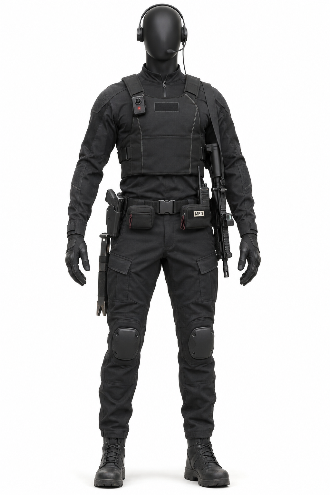
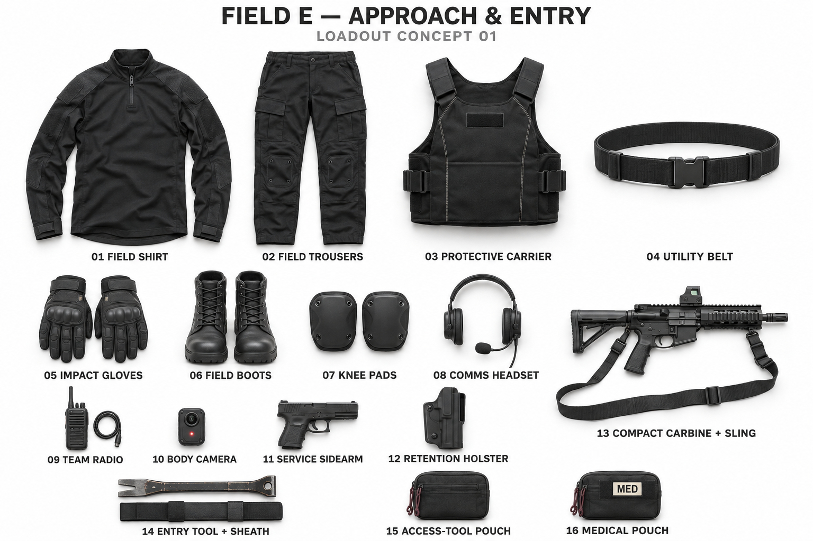

# Field-E — Approach & Entry visual reference

## Concept images

The owner supplied both photographs on 2026-11-02 as the reference for this archetype. They were made with ChatGPT image generation. This is the presentation that Recon's FO-R-SO pair follows:
- the same faceless matte-black mannequin;
- a white seamless background;
- one dressed photograph, then one labeled flat lay.

They are concept photographs, not dimensionally certified production assets. The index for all operators is [`phenotypes/operators/LOADOUTS.md`](../../../phenotypes/operators/LOADOUTS.md).

## What the pictures establish

| # | Item | Where it sits (the mannequin's own left/right) |
|---|---|---|
| 01 | Field shirt | Quarter-zip, long sleeve, reinforced shoulders and forearms |
| 02 | Field trousers | Cargo pockets; knee panels take the pads |
| 03 | Protective carrier | Torso, over the shirt; blank identification panel at the chest |
| 04 | Utility belt | Waist, with a quick-release buckle |
| 05 | Impact gloves | Knuckle-protected, full finger |
| 06 | Field boots | Laced, high ankle |
| 07 | Knee pads | Over the trouser knees |
| 08 | Comms headset | Over-ear with a boom microphone; the head otherwise uncovered |
| 09 | Team radio | Belt, mannequin's left, behind the slung carbine |
| 10 | Body camera | High on the mannequin's right chest, on the carrier; small red record light |
| 11 | Service sidearm | In the holster |
| 12 | Retention holster | Mannequin's right hip |
| 13 | Compact carbine + sling | Slung on the mannequin's left side, muzzle down, red-dot optic |
| 14 | Entry tool + sheath | Pry-style tool hanging at the mannequin's right thigh, beside the holster |
| 15 | Access-tool pouch | Front of the belt, on the mannequin's right of the buckle |
| 16 | Medical pouch | Front of the belt, on the mannequin's left of the buckle, marked "MED" |

Against [FO-E](../../../phenotypes/operators/field-entry/FO-E.md), this profile carries the highest protection of the three (the carrier and knee pads), mechanical entry tools and a primary weapon. It has no full helmet; the advanced headset is its head equipment.

## Constraints for anyone reproducing it

- **No marks.** The identification panel stays blank: no M, no Dual Sight, no red `//`. Approved marks come only from the locked masters, applied whole. The "MED" text on the medical pouch is a functional label, not a brand mark.
- **No Prime −1 M helmet** and no full helmet.
- **No added gear.** No explosives, no drone, no large backpack, and no technical cyberdeck: that belongs to Technical.
- **Every item exactly once** in the flat lay, the same as on the mannequin.
- **Other profiles get their own pair.** A different Entry mission profile is a new versioned pair; it does not edit these images.
