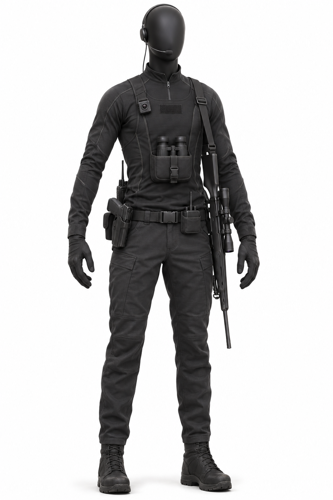
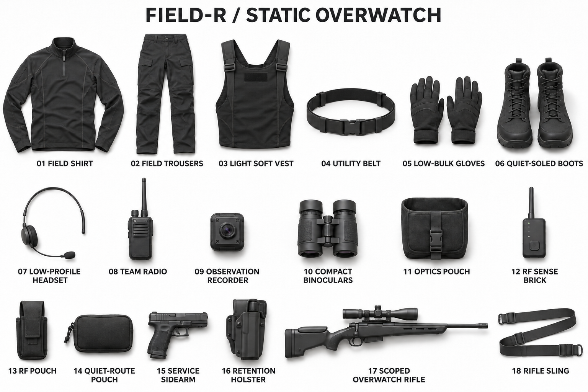

# Field-R — Recon / Overwatch visual reference

## Concept images

Both photographs were generated with the built-in image-generation workflow. The mannequin uses the preceding Field-E photograph as a presentation reference. The flat lay uses the Recon mannequin as its equipment reference. A final targeted correction removed the duplicated recorder, binoculars and pouch from the vest in the flat lay; those accessories appear once in their separate inventory positions. These are concept photographs, not dimensionally certified production assets.

## Purpose and source boundaries

This is the Recon counterpart to the Field-E mannequin presentation: one fully dressed, faceless matte-black mannequin on a white seamless background, followed by one separate photograph of its complete equipment laid out and labeled on the same white surface. The owner requested the same visual and written treatment for Recon on 2026-11-02.

The selected profile is **FO-R-SO, Static Overwatch**. [Field Kits](../../../phenotypes/operators/FIELD-KITS.md) supplies the canonical shared visual language and Recon equipment categories. The [FO-R phenotype](../../../phenotypes/operators/field-recon/FO-R.md), currently PROPOSED, supplies the lightest armor, controlled signature, optics, recording and mission-authorized longer weapon. This image chooses that longer weapon for an overwatch assignment; it does not make a rifle mandatory for every Recon profile.

The exact garment construction, equipment placement, eighteen-group presentation and mannequin pose below are new concept decisions. They are not approved production dimensions or a change to story canon. A mannequin has no assigned character age or season. Its faceless finish is a presentation convention.

## Detailed visual description

Recon stands on a pure white studio floor in a relaxed, upright catalog pose, feet slightly apart and arms held far enough from the torso to reveal the clothing and belt equipment. The head and exposed neck are smooth matte-black mannequin surfaces. There are no facial features, skin, hair or expressive eyes. A near-frontal three-quarter camera angle shows the narrow torso, the equipment placement and the full silhouette from the crown of the head to the boot soles.

The first impression is long, spare and mobile. A close-fitting charcoal technical field shirt has a short standing collar and a quarter-length front zip. Its shoulders and outer sleeves use a slightly tougher matte weave; the inner elbows and underarms use a more flexible dark knit. Small changes of texture separate the materials without turning the outfit into a patchwork of colors. The shirt has enough ease for reaching and climbing, with no loose hanging fabric. Restrained seam lines are graphite, with only occasional very dark ivory stitching visible at close range.

Over the shirt is a thin black soft protective vest. Its edges bend with the torso, the shoulders remain narrow, and the lower hem stops above the belt. The surface is almost flat, interrupted by the optic pouch and a tiny recorder. There are no large rigid panels, square armor shoulders or thick stacked plate outlines. The front identification area is a plain black fabric cover. The image does not invent or redraw institutional marks.

The trousers continue the graphite silhouette. They are articulated at the knees, with low-profile reinforced fabric rather than separate hard knee caps. Flat pockets follow the thighs; the seat and inner-leg panels use a quieter, softer finish. The cuffs taper into compact mid-height field boots. Those boots have flexible ankles, broad matte rubber soles and rounded, modest tread edges. Their shape supports both careful movement and long periods holding a position.

The gloves are thin, black and close fitting, with textured palms and flexible fingers suited to optics and small controls. The wrists remain clear. The headset is a narrow earpiece and fine boom microphone with a slim retention band; the rest of the mannequin's head stays uncovered. The wire runs close to the body into the clothing. The generated mannequin places the compact team radio toward the rear of the right waist, behind the holster; this is the reference placement for these images.

The binoculars are Recon's most immediate role cue. A compact pair of dark, rubber-armored binoculars sits partly visible in a shallow padded pouch centered at the lower sternum. The glass is recessed and has no exaggerated glowing lenses. A small rectangular observation recorder clips high on the right chest. It has a modest dark lens and a single subdued status point. It looks like equipment for retaining the team's observations, not a decorative camera array.

A palm-sized RF sensing brick rides in a shallow pouch at the left front of the belt. Its short antenna and upper edge remain visible. A small, closed quiet-route pouch sits toward the right rear waist. The latter contains the profile's simple marking supplies as an inventory category; the presentation does not spill loose tools around the mannequin. The slim belt and these few pouches leave the abdomen and the fronts of the thighs clear.

The service sidearm sits in a close-fitting retention holster at the right hip, using the same compact, plain-black design family as E's. The mission-authorized overwatch rifle hangs along the left side on a simple dark sling, muzzle pointed down in this catalog pose. It has a relatively slender body and a modest long optic. Its outline is clearly longer than E's compact primary, but it does not overwhelm Recon's lightweight silhouette. There are no extra magazines displayed, oversized attachments or loose ammunition in this reference.

Materials should remain distinguishable inside the dark palette: fine woven shirt fabric, slightly softer trousers, flexible vest textile, rubber-covered optics, satin polymer device housings, dull metal on the rifle, and lightly worn boot rubber. Wear appears at the boot toes, trouser knees, pouch edges and sling contact points. The equipment is maintained and serviceable. Bright red panels, glossy trim and dramatic battle damage would break the intended low-signature appearance.

## Locked presentation inventory

The mannequin and flat lay must contain the same eighteen labeled groups. Paired gloves and boots each count as one group. The rifle's installed optic belongs to group 17. Radio cable and headset fittings remain with their respective devices. The inventory is a visual continuity list, not a full logistics manifest.

| Label | Exact item name | Appearance and placement in mannequin image |
|---|---|---|
| 01 | Field shirt | Charcoal long sleeves, short stand collar, quarter zip; worn beneath vest. |
| 02 | Field trousers | Dark graphite, articulated knees, flat pockets, tapered cuffs. |
| 03 | Light soft vest | Thin flexible black torso protection; plain covered identification area. |
| 04 | Utility belt | Narrow matte-black belt with a small low-profile buckle. |
| 05 | Low-bulk gloves | One matching pair, black, flexible fingers, textured palms. |
| 06 | Quiet-soled boots | One matching pair, compact mid-height black boots, subdued rubber tread. |
| 07 | Low-profile headset | Small earpiece, fine boom microphone and slim retention band. |
| 08 | Team radio | Compact black radio toward the right rear waist, behind the holster; cable routed close to the torso. |
| 09 | Observation recorder | Small rectangular device high on the right chest; dark lens. |
| 10 | Compact binoculars | Short rubber-armored dark binoculars; partly visible in chest pouch. |
| 11 | Optics pouch | Shallow padded black pouch centered at lower sternum. |
| 12 | RF sense brick | Palm-sized dark device, short antenna, no large illuminated screen. |
| 13 | RF pouch | Close-fitting shallow pouch on left front belt; carries group 12. |
| 14 | Quiet-route pouch | Small closed black pouch at right rear waist; no loose contents shown. |
| 15 | Service sidearm | Compact plain-black sidearm in the shared E/R/T family. |
| 16 | Retention holster | Close-fitting black holster at right hip; carries group 15. |
| 17 | Scoped overwatch rifle | Lightweight longer primary with installed matte optic; slung on left side. |
| 18 | Rifle sling | Plain dark fabric sling supporting group 17; no hanging decorative straps. |

## Photograph A — dressed mannequin

**Prompt specification:** Product-mockup photograph for PRIM3. Character ID FO-R, mission profile FO-R-SO Static Overwatch, asset status DRAFT concept, season-neutral mannequin reference. A full-body faceless matte-black display mannequin wears the exact eighteen-group inventory above. Dark institutional field clothing; thin flexible soft protection; optics and compact sensing equipment define the silhouette. Quiet, deliberate, lightweight Recon identity. White seamless studio backdrop and white floor, no horizon line, soft contact shadow. Full figure centered with generous margins, near-frontal three-quarter view, realistic 70 mm product-photography perspective, soft large studio lights and subtle edge separation. Materials and mild field wear match the detailed description. Sidearm holstered at right hip and longer scoped primary slung at the left side, muzzle down. Preserve E's mannequin-and-white-background presentation convention while making R visibly lighter and more observation-focused. No added title or caption inside this photograph.

**Continuity constraints:** Exactly the listed garments and equipment. Binoculars and RF brick remain distinguishable from their pouches. Optic remains installed on the rifle. No full helmet, rigid plate carrier, Prime M helmet structure, Mission Core, technical cyberdeck, entry/breaching tools, explosives, drone, large backpack, ghillie suit or invented accessories. No human face or skin. No logos, generated institutional symbols, unauthorized insignia or watermark. Covered identification area stays blank.

## Photograph B — matching labeled loadout

**Prompt specification:** Product-mockup equipment inventory photograph for PRIM3, character ID FO-R, profile FO-R-SO, asset status DRAFT concept, season-neutral. Use Photograph A as the visual source for all items, proportions, materials, weathering and design details. Remove the mannequin. Arrange the eighteen groups on a white seamless studio floor in a spacious, orderly flat lay with realistic soft contact shadows. All items lie fully inside the frame without overlap. Clothing is laid out flat rather than worn or hovering. Remove the binoculars from their pouch, RF brick from its pouch, sidearm from its holster and sling from its rifle, placing each as its own listed group. Keep the rifle optic installed. Display glove and boot pairs together. Add one clear, understated dark sans-serif label below each item using the exact numbered item names in the inventory table. Maintain generous white spacing around labels and equipment. The rifle may occupy a longer dedicated row or column to retain plausible proportions. Straight overhead camera, even studio light, no perspective trick that makes the equipment look miniaturized.

**Continuity constraints:** Exactly eighteen labeled groups, no duplicated equipment, no missing pouches, no new supplies. No bullets, extra weapons, loose kit contents, helmet, drone, cyberdeck, breaching tools, mannequin body parts, decorative logos or watermark. This requested catalog flat lay is a presentation image, not a replacement for the separate four-view object photographs required for later 3D asset production.

## Shared learning identity

Recon shares **Math, Science and Information Technology** with E and T. This profile emphasizes observing, estimating, interpreting sensor information and maintaining an accurate picture of the terrain and opponents. Those emphases do not remove any shared subject or make the other roles unable to perform basic actions. The mannequin reference communicates the specialty through silhouette and equipment; curriculum tiers and gameplay balance remain separate design work.

## Review boundary

Approval of this concept would establish the chosen look and inventory for this version of FO-R-SO. It would not approve every future Recon profile, final item dimensions, weapon statistics, a specific season appearance or finished game meshes. The two requested images must first be checked against the eighteen-group continuity list.
