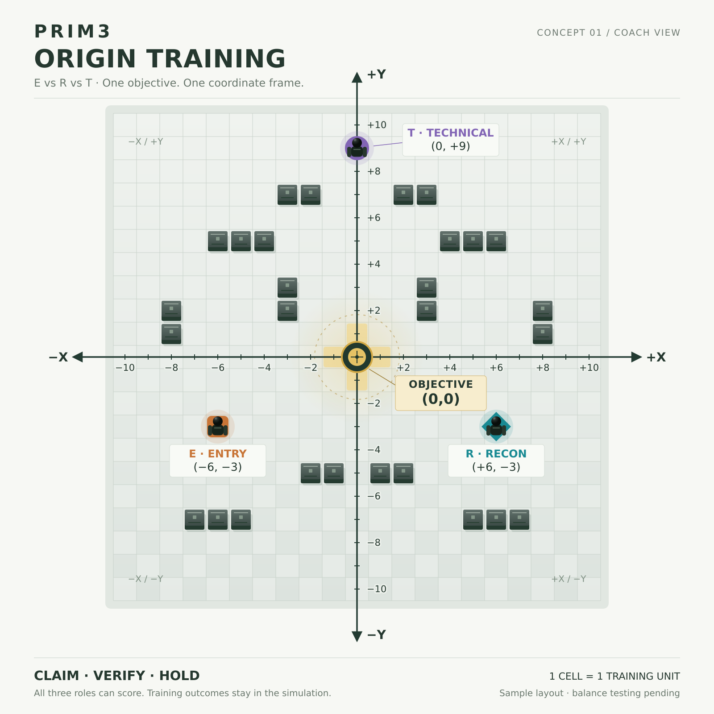

# Objective-centered training reference



The owner requested centered X/Y axes, a primary objective at (0,0), and an E/R/T competitive training exercise on 2026-11-02. The [design specification](../../../game/OBJECTIVE-CENTERED-TRAINING.md) separates those requirements from proposed balance details.

- [Editable SVG](PRIM3-objective-origin-training-v01.svg)
- [Coordinate fixture](objective-origin-training-v01.json)
- [Deterministic renderer](../../../development/render_objective_training_map.py)

The 1600 × 1600 canvas places the origin at exactly (800,800) pixels. Both axes use 52 pixels per training unit, with +X right and +Y up. Integer coordinates denote tile centers; boundaries lie at half-integers. The visible centers run from -10 through +10 (21 centers and 20 center-to-center intervals). HUD labels do not move the coordinate origin.

The image is an orthographic coaching reference with all three sample operators visible. Its role colors are draft presentation overlays, not uniform color canon. Cover is illustrative training geometry, not Site 0 or Equity Uprise architecture. The black mannequin map symbols are schematic markers, not finished character models.

The relay occupies the non-walkable origin tile. Four orthogonally adjacent highlighted tiles are common interaction positions available to E, R and T. No path or claim of competitive balance is implied by the visual. The renderer checks that each starting position can reach an interaction tile through the declared cover layout.

## Reproduce

From the repository root, generate the SVG with Python 3:

```bash
python3 development/render_objective_training_map.py
```

With Inkscape installed, regenerate both committed image formats:

```bash
python3 development/render_objective_training_map.py --png
```

This is a design reference. It does not implement multiplayer, gameplay, learner persistence or the final 3D Training Range.
