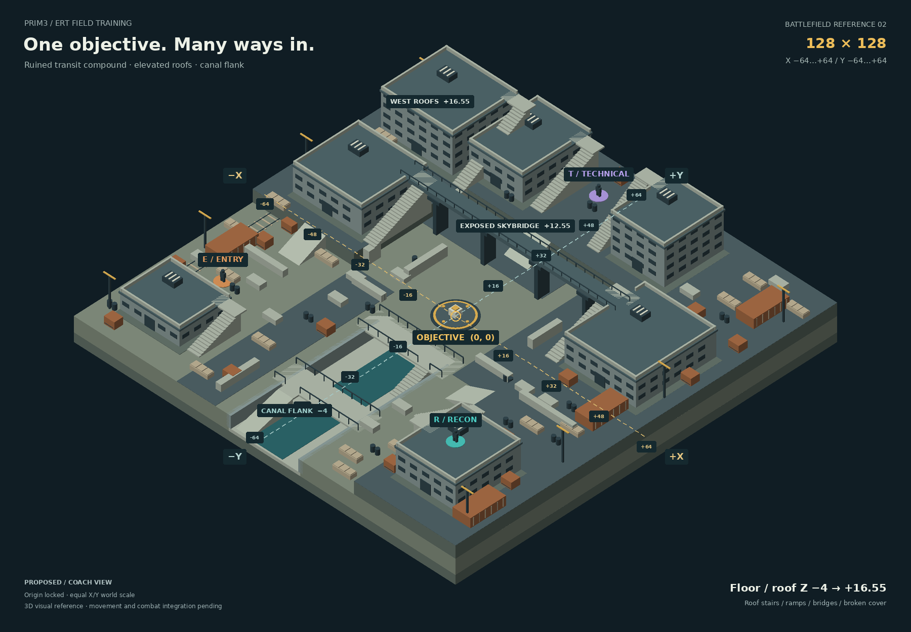

# Objective-centered 3D battlefield reference



The owner rejected the small flat `v01` arena on 2026-11-02. Training arenas must include **-50 through +50 on both X and Y at minimum**, with a 3D tactical view, substantial terrain and cover, climbable structures and dangerous objective approaches. This replacement spans **-64 through +64: 128 × 128 training units**.

- [Open the offline 3D scene](PRIM3-objective-origin-training-v02.html)
- [Rendered battlefield PNG](PRIM3-objective-origin-training-v02.png)
- [Scene and coordinate data](objective-origin-training-v02.json)
- [Scene generator](../../../development/render_battlefield_v02.py)
- [Design specification and proposed exercise rules](../../../game/OBJECTIVE-CENTERED-TRAINING.md)

Download the HTML and open it in a WebGL-capable browser to inspect the offline scene; GitHub's file view displays its source. Drag to orbit and scroll to zoom while the origin stays centered. The scene is a visual interaction preview. Camera and display controls do not constitute a playable combat mission.

| Control | Effect |
|---|---|
| Coordinates | Show or hide the projected X/Y axes, signed ticks and grid |
| Approaches | Show or hide illustrative route waypoints; these are not pathfinding results |
| Roof cutaway | Hide building walls, roofs and attached facade details for inspection; this does not change gameplay collision |
| Reset view | Restore the reference camera angle and zoom |

## World and presentation

The industrial ravine and ruined transit compound combines lower passages, working yards, elevated decks, bridges, roofs, stairs and ramps. Layered approaches and substantial cover make the center a contested destination. Elevated positions illustrate the owner's request for Recon to threaten rivals approaching the objective.

X and Y describe horizontal world position; Z describes elevation. The objective at **(0,0)** is the camera target and screen center. Its projected world axes meet there and change angle honestly under 3D orbit. A north-up plan convention has +X right and +Y up; an angled 3D projection does not promise those same screen directions.

The sample coaching starts are E at **(-48,-30,0)**, R at **(+44,-44,12.55)** and T at **(-4,+52,4.1)**. Reference walk-surface levels span **-4 to +16.55**, including intermediate ground, roof and bridge levels; railings and roof apparatus extend above them. These stage different ground and elevated roles for inspection; they are not an approved balanced match. Coach visibility is not gameplay visibility. Role colors are draft interface overlays, not uniform canon. The compound is not established Site 0 or Equity Uprise architecture.

The geometry and route examples express visual intent. Final gameplay must validate navigation, access links, cover, line of sight, AP costs, shooting, damage, elimination, objective control and return/reset behavior through the existing tactical resolver. Occupying the objective is not a protected interaction.

## Reproduce

From the repository root, generate the JSON, offline HTML and PNG with Python 3, NumPy and Pillow installed:

```bash
python3 development/render_battlefield_v02.py
```

To generate only the JSON and HTML with Python's standard library, use:

```bash
python3 development/render_battlefield_v02.py --no-png
```

The PNG is a software render of the same authored meshes at the reference camera view. The HTML uses WebGL and includes its data locally; it needs no external asset or library downloads. A north-up plan view is a possible future teaching option in the specification, not an implemented preview control.

## Verified visual behavior

The final reference contains seven buildings, 78 cover groups and 14 authored access links. Generator checks verify the minimum arena extent, the objective origin, role positions and access endpoints. The JavaScript parses successfully and all rendered mesh faces have valid normals.

The HTML was checked in Chromium with WebGL: camera orbit, zoom, resize and all display controls work without JavaScript errors. The origin stayed at `(800,550)` in a `1600 × 1100` viewport and at `(195,422)` in a `390 × 844` viewport. The mobile layout has no horizontal overflow and retains its visible controls and notes. Roof openings, stair landings, ramp endpoints and canal bridge access were visually reviewed and corrected. These checks validate the scene preview; they do not certify gameplay navigation, line of sight or competitive balance.

## Superseded v01

The `v01` PNG, SVG and JSON and `development/render_objective_training_map.py` are retained as historical design artifacts. They use -10 through +10 and a flat overhead presentation. **They do not satisfy current training-arena requirements and must not be used as a valid new arena template.**

This reference changes no course numbering, story chronology, campaign consequences or learner-progress authority. Gameplay integration remains pending.
