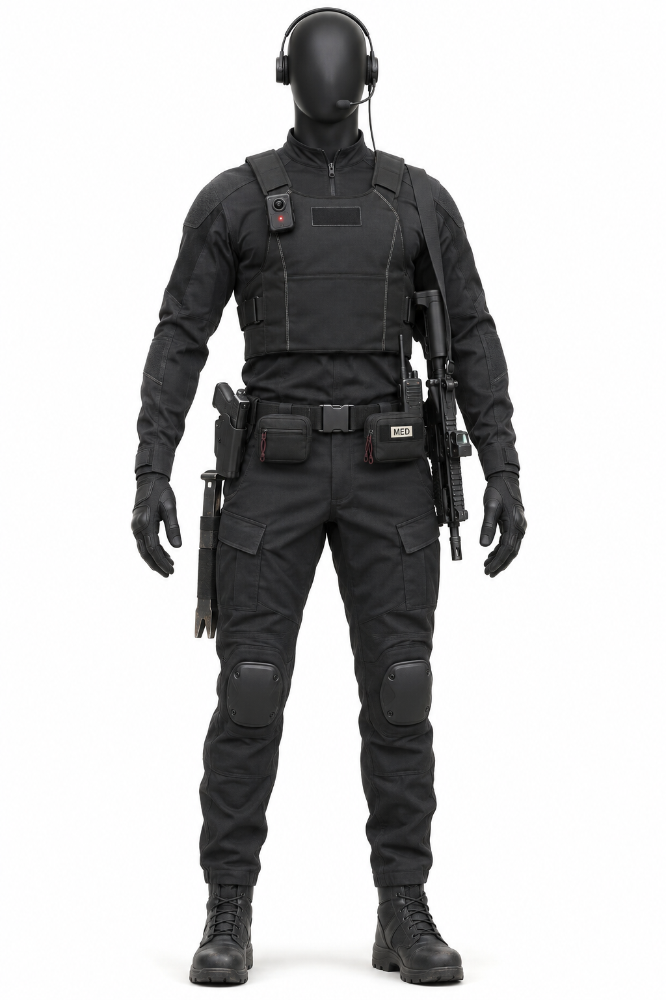
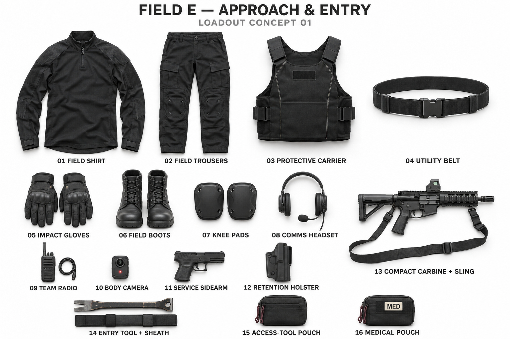
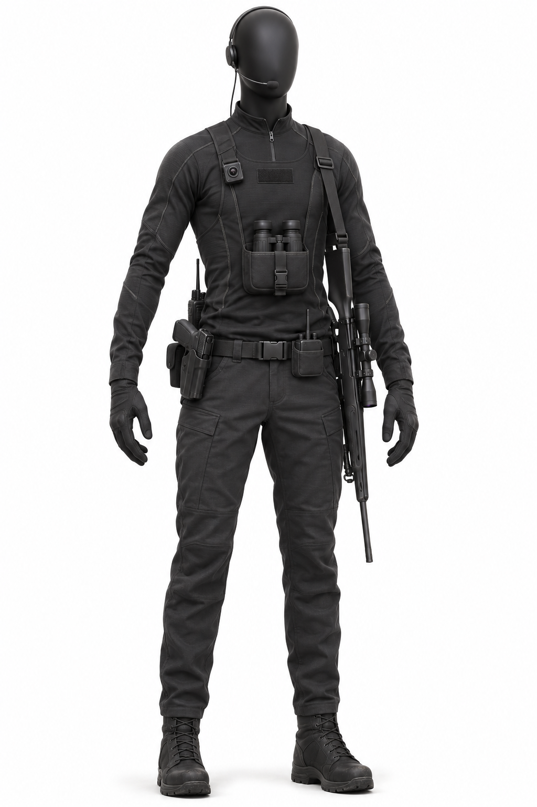
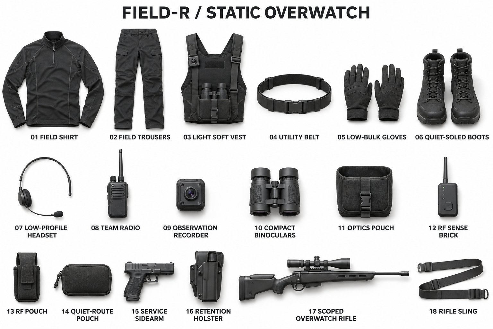
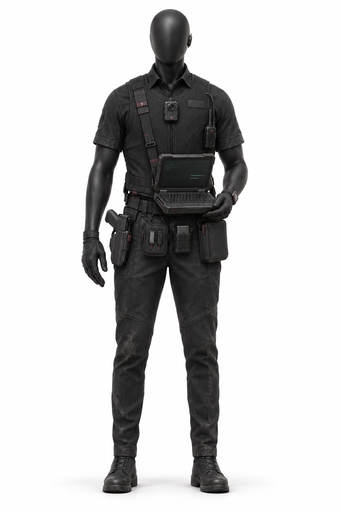
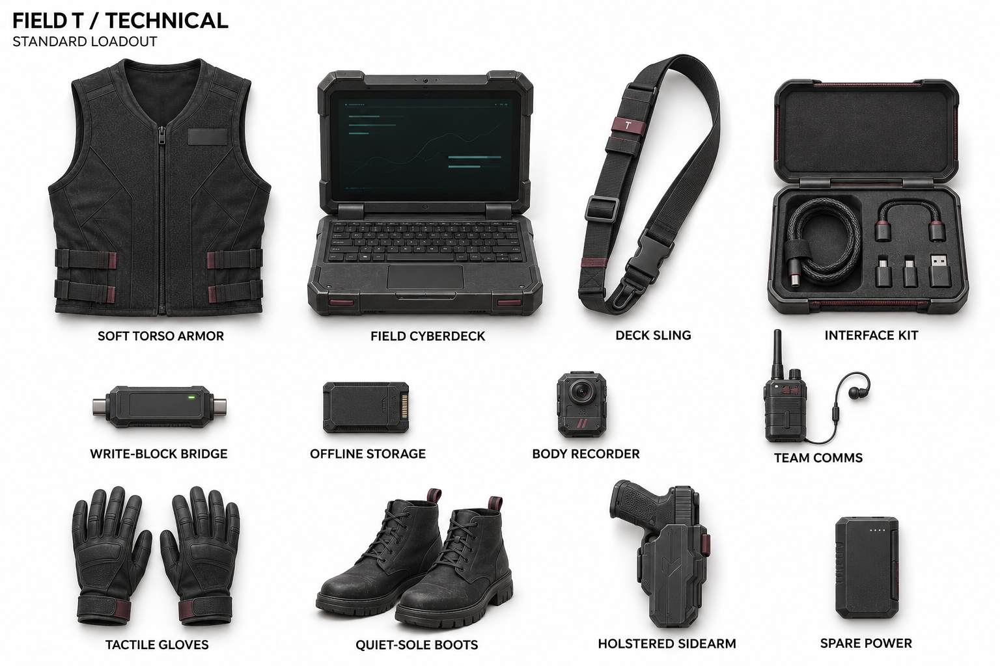

# Field operator loadouts — the one place to look

**Every agent (Claude, Codex, ChatGPT, Gemini, Cursor):** before you draw, model, generate, describe or put a Field operator in a game, read this page. It shows what each operator looks like dressed, and every item they carry.

The owner set this up on 2026-11-02 so that all agents work from the same pictures.

Each operator has two reference photographs:
- **Mannequin:** one faceless matte-black mannequin, fully dressed, on a white seamless background.
- **Loadout:** the same equipment laid flat and labeled, one numbered group per item.

| Operator | Profile | Mannequin | Loadout | Written brief |
|---|---|---|---|---|
| **E — Entry** | FO-E-AE, Approach & Entry | [mannequin](../../assets/reference/field-entry/FO-E-AE-mannequin-v01.png) | [loadout](../../assets/reference/field-entry/FO-E-AE-loadout-v01.png) (16 groups) | [FO-E-AE visual brief](../../assets/reference/field-entry/FO-E-AE-visual-brief-v01.md) |
| **R — Recon** | FO-R-SO, Static Overwatch | [mannequin](../../assets/reference/field-recon/FO-R-SO-mannequin-v02.png) | [loadout](../../assets/reference/field-recon/FO-R-SO-loadout-v02.png) (18 groups) | FO-R-SO visual brief (arrives with Prim3 PR #17; describes v01) |
| **T — Technical** | FO-T-STD, Standard | [mannequin](../../assets/reference/field-technical/FO-T-STD-mannequin-v01.png) | [loadout](../../assets/reference/field-technical/FO-T-STD-loadout-v01.png) (12 groups) | This section; itemized text in [LOADOUTS-ITEMIZED.md](field-technical/LOADOUTS-ITEMIZED.md) |

## E — Entry · Approach & Entry (FO-E-AE)

| # | Item | # | Item |
|---|---|---|---|
| 01 | Field shirt | 09 | Team radio |
| 02 | Field trousers | 10 | Body camera |
| 03 | Protective carrier | 11 | Service sidearm |
| 04 | Utility belt | 12 | Retention holster |
| 05 | Impact gloves | 13 | Compact carbine + sling |
| 06 | Field boots | 14 | Entry tool + sheath |
| 07 | Knee pads | 15 | Access-tool pouch |
| 08 | Comms headset | 16 | Medical pouch |

**Read at a glance:** the heaviest protection of the three, a short carbine slung, a pry-style entry tool on the hip, knee pads for door and stair work, and a body camera high on the chest with a red record light. It is the operator who goes through the door first and holds it ([FO-E](field-entry/FO-E.md)).

## R — Recon · Static Overwatch (FO-R-SO)

**v02 is the active Recon reference.** The owner designated it on 2026-11-02 ("This is R"). Codex's v01 pair in Prim3 PR #17 stays as history and is not the reference. In v02 the flat lay shows the light soft vest (03) as worn, with the observation recorder and binoculars in their pouch; items 09–11 also appear separately. Count each item once.

| # | Item | # | Item |
|---|---|---|---|
| 01 | Field shirt | 10 | Compact binoculars |
| 02 | Field trousers | 11 | Optics pouch |
| 03 | Light soft vest | 12 | RF sense brick |
| 04 | Utility belt | 13 | RF pouch |
| 05 | Low-bulk gloves | 14 | Quiet-route pouch |
| 06 | Quiet-soled boots | 15 | Service sidearm |
| 07 | Low-profile headset | 16 | Retention holster |
| 08 | Team radio | 17 | Scoped overwatch rifle |
| 09 | Observation recorder | 18 | Rifle sling |

**Read at a glance:** the lightest of the three. The mannequin has a long-sleeve quarter-zip, a slim headset and a light chest rig. Binoculars sit in a pouch at the sternum, the observation recorder is clipped high on its right chest, and the radio is on the belt beside the right-hip holster. A sling runs over the left shoulder. The scoped rifle is slung muzzle-down and appears only in this overwatch profile; it is not mandatory for every Recon profile ([FO-R](field-recon/FO-R.md)).

## T — Technical · Standard (FO-T-STD)

| Item | Where it sits (the mannequin's own left/right) |
|---|---|
| Soft torso armor | Zip-front soft vest over a **short-sleeve** collared field shirt; blank identification panel on the left chest |
| Field cyberdeck | Rugged clamshell deck, held open at waist height on the deck sling |
| Deck sling | Over the right shoulder, across the chest; carries a small "T" role tab |
| Interface kit | Hard case with cables and adapters; carried in a belt pouch |
| Write-block bridge | Small inline adapter; belt pouch |
| Offline storage | Rugged drive; belt pouch |
| Body recorder | Centre of the chest, high on the vest |
| Team comms | Radio on the left chest strap, with an earpiece |
| Tactile gloves | Thin, close-fitting, textured palms |
| Quiet-sole boots | Laced, low-profile |
| Holstered sidearm | Retention holster on the right hip |
| Spare power | Battery pack; belt pouch |

**Read at a glance:** the only short-sleeved operator, so the mannequin's arms show from the elbow. The open cyberdeck is held in front on its sling, and the belt carries a row of small pouches. He has the lightest weapon load of the three: a sidearm only, no long gun.

**One correction for anyone reproducing it:** the body recorder in both photographs carries small red diagonal stripes. They resemble the red `//` mark. Under the no-marks rule, leave them off in 3D models and new images, or apply the locked master whole. The "T" on the sling is a role letter, not a brand mark.

## Rules for using these pictures

- **Status: DRAFT concept, not canon.** They are not production dimensions. A mannequin has no age, season or identity. Approved canon still comes from `CANON.md` and approved files, in the order set by `AGENTS.md`.
- **No marks.** The covered identification panels are blank on purpose. Do not draw, trace or approximate the M, Dual Sight or red `//` on these operators. If a mark is wanted, it comes from the locked masters in `assets/canon/brands/mccluster-corp/marks/`, scaled whole. Prime −1's M helmet is not a Field operator item: never put it on E, R or T.
- **One profile per pair.** These are the Approach & Entry and Static Overwatch profiles. Another mission profile (for example a Recon without the rifle) gets its own pair. It is never a silent edit of these images.
- **3D models.** For image-to-3D generation:
  - use the mannequin photograph as the reference;
  - follow `phenotypes/ASSET-REPLICATION-STANDARD.md` (separate front, back and side views when they exist);
  - output one GLB per role.

  The PRIM3 tactics preview in `mcclusterishere/mccluster` loads them from `assets/3d/prim3-operators/` (E, R, T, plus H for a known hostile).
- **Changing a loadout:** add `-v02` files beside the current ones, update the table above, and say why in the brief. Never overwrite a version.

## Sources

| File | Origin |
|---|---|
| `FO-E-AE-mannequin-v01.png`, `FO-E-AE-loadout-v01.png` | Supplied by the owner, 2026-11-02 (ChatGPT image generation) |
| `FO-T-STD-mannequin-v01.png`, `FO-T-STD-loadout-v01.png` | Supplied by the owner, 2026-11-02 |
| `FO-R-SO-mannequin-v02.png`, `FO-R-SO-loadout-v02.png` | Supplied by the owner, 2026-11-02 ("This is R"): the active Recon reference |
| `FO-R-SO-*-v01.png` (in Prim3 PR #17, not on this branch) | Codex; superseded by the owner's v02 |
