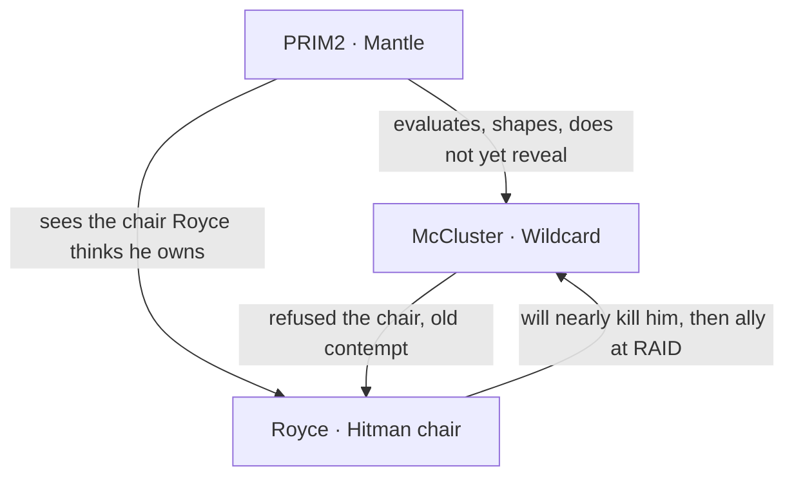
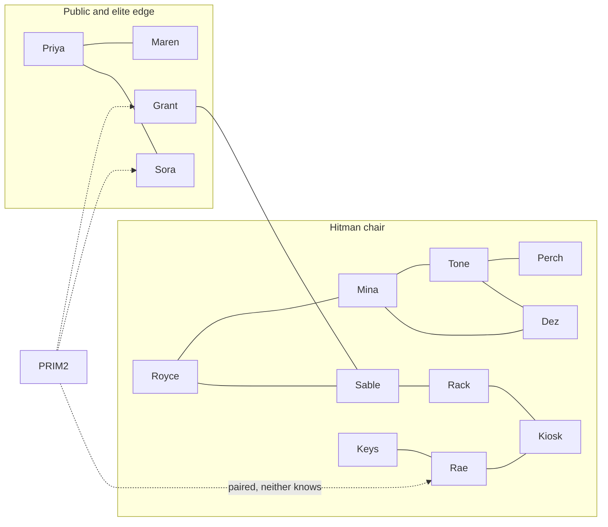

# Relationship graph

Use this when deciding who is on whose side, who has leverage, and what a scene should move.

Winning sources, in order:

1. `../CANON.md`
2. `CHARACTER-RELATIONSHIP-STATE.md`
3. Character specialist files (`AYA-CIRCLE-RELATIONSHIP-WEB.md`, `HITMAN-CAST.md`, `HITMAN-CHARACTER-DOSSIERS.md`, psychological backgrounds)
4. This graph
5. `RELATIONSHIP-ECOSYSTEM.md` only where it does not conflict with McCluster entering at 33, Aya already being inside, or Benji being McCluster

`RELATIONSHIP-ECOSYSTEM.md` remains on file. It is older pre-story texture. It does not outrank the ledger above it.

## How to read an edge

```text
KIND        what the bond is
STATE       opening of PRIM3 unless noted as endgame
LEVERAGE    who can make the other pay a cost
SECRET      what one side does not know
MOVE        the smallest change a later scene is allowed to make
```

Kinds: `kin`, `love`, `ex`, `friend`, `mentor`, `rival`, `command`, `alliance`, `debt`, `grief`, `instrument`.

`instrument` means one person is being used and does not have the full picture. It is not the same as an alliance.

## Nodes

Immediate recurring cast, 39. Benji is not a node. Benji is McCluster, ages 19–26.

**Equity Uprise / McCluster Corp (24):** McCluster, Aya Shinoda, Arjun Mehta, Li Wei, Sari Wulandari, Hassan Raza, Chioma Okeke, Rafael Costa, Nusrat Rahman, Dmitri Volkov, Oksana Bondarenko, Yonas Bekele, Valeria Soto, Amira Hassan, Miguel Santos, Grace Mbala, Minh Tran, Leila Hosseini, Emre Yıldız, Jonas Weber, Priya Srisawat, Helen Clarke, Marc Dubois, Thandiwe Nkosi.

**Public / system (3):** Maren Quill, Pylon, PRIM2.

**Hitman (12):** Royce, Sable Quinn, Grant Voss, Tone Rivera, Kira "Keys" Moon, Omar "Rack" Dillon, Jules "Kiosk" Mendez, Rae "Twin" Colton, Chris "Perch" Alvarez, Dez "Switch" Calhoun, Mina "Halo" Brooks, Sora "Gymnast" Okada.

**Promoted outside the 39.** They are real. They are not a second workplace cast.

Hana Lee (dead before McCluster arrives), Ren Shinoda, Masato Shinoda, Keiko Shinoda, Tariq Al-Farsi, Zayd Al-Harthi, Bigga Lex the Jet (retired).

The 48 names in `CAST-NATIONS.md` stay a development pool. Do not draw edges to them until a person is promoted on purpose.

---

## Power blocs at opening

These are the sides a scene can pull on. People can sit in more than one. That is the point.

| Bloc | Who holds it | Who is in it | Crack |
|---|---|---|---|
| **Mantle** | PRIM2 | PRIM2, and possibly Pylon if hidden integration is later proven. Not proven at opening. | The Mantle only works while the living holder is valid. RAID is the crack. |
| **Visible institution** | Helen, on paper. PRIM2, in fact. | Equity Uprise mains who experience the school as real, because it is real. | Good work is how PRIM2 keeps people from looking up. |
| **GLASSHOUSE scar** | Nobody. The scar is shared and the blame is not. | Amira, Marc, Aya, Helen. Hana is the absent center. | Amira was right and could not stop it. Marc's arithmetic killed someone. Neither knows PRIM2 held the missing fact. |
| **After-PRIM2 argument** | Not settled. | Chioma (use authority), Thandiwe (fear what authority does), Helen (governance that can survive the man). | One of them will someday accept a compromise the others call harm. |
| **Institution as threat** | Shared private work, no public chair. | Li Wei, Leila Hosseini. | The first one who reports upward without consent breaks the pair. |
| **Floor / physical truth** | No single chair. Procedure is the power. | Hassan, Dmitri, Emre, Nusrat, Miguel. Oksana sits adjacent through evidence, not a post. | A root-level override can make a correct local decision look like it lost. |
| **Machine dependence** | Pylon, operationally. Jonas, emotionally. | Jonas, Pylon. Emre is the brake, not a member. | Jonas will eventually have to shut Pylon off or trust an explanation he cannot check. |
| **Public surface** | Priya and Maren, until a sponsor leans on them. | Priya, Maren. Sora is a contractor on the edge. | A polished account both of them know is false. |
| **Hitman chair** | Royce | Royce, Sable, Rack, Tone, Mina, Dez, Keys, and the cell. Grant thinks he is outside it. | Sable can tell Royce the truth his mythology cannot afford. Mina is loyal to the people who come home, not to the crown. |
| **Respectable money** | Grant thinks so. PRIM2 knows better. | Grant Voss, with Sable as the practical interface. | Grant's distance is not innocence. PRIM2 already priced him. |
| **Split access** | PRIM2, hidden. | Rae on the street, Sora in elite rooms. They are not allies yet. Keys mentors Rae. Priya knows Sora as a contractor. | The day they learn they were paired. |
| **Aya's country** | Aya does not hold it. They hold her. | Ren, Masato, Keiko, Tariq, Zayd, and dead Hana. | This is the bloc that can tell Aya she is managing someone instead of loving them. |
| **Succession triangle** | PRIM2, until he isn't. | PRIM2, McCluster, Royce. | They only become a temporary alliance after both assault teams are dead. |



---

## Locked edges

Opening state unless the note says endgame. Sources are the files named in the header.

### Succession and old lives

| Edge | Kind | State | Leverage | Secret | Move |
|---|---|---|---|---|---|
| PRIM2 → McCluster | instrument | Evaluative. McCluster does not know the relationship exists. | PRIM2, maximal at opening, narrowing over seven years. | Ghost-year trace, the engineered intersection, the police tip, the haircut reacquisition. | McCluster learning how much of the path was watched. |
| McCluster ↔ Royce | rival | Old, asymmetric, pre-PRIM3. | Royce has the chair. McCluster has the history of having given it away. | How much of Royce's reign was visible to PRIM2. | RAID: sole survivors, almost murder, then a temporary alliance. |
| McCluster → Royce | debt | McCluster handed a worse man a crown to protect Lex's children. | The debt sits on McCluster. | Royce may read the handoff as respect or as insult. Still open which. | A scene where Royce names the handoff. |
| Bigga Lex → McCluster | friend | Retired. Lex offered the chair. McCluster refused so Lex would stay a father. | Lex's loyalty used to be the danger. | Lex does not need the Mantle story. | Do not pull Lex back into a war to decorate a scene. |
| PRIM2 → Royce | instrument | PRIM2 holds the cross-board picture. Royce holds a chair inside one board. | PRIM2. | Royce does not know he is on a sibling board. | Royce discovering the chair was never the top. |
| Grant → PRIM2 | instrument | Grant thinks money makes him a client. | PRIM2. | Grant's moral distance is already priced. | A trace that makes Grant personally visible. |

### Aya's country

| Edge | Kind | State | Leverage | Secret | Move |
|---|---|---|---|---|---|
| Aya ↔ Hana | grief / mentor | Hana is dead. Trust in life was real and incomplete. | Hana still has it, through Kkeutori. | NIS role. Living Root. PRIM2's hand in GLASSHOUSE. | One breadcrumb becoming legible. Not the whole chain at once. |
| Aya ↔ Ren | kin | Extremely high trust, hard boundary. | Ren. He can refuse her. | How much of her Equity Uprise danger she hides from the family. | She asks what he wants instead of fixing him. |
| Aya ↔ Masato | kin | Love as maintenance. | Soft. He notices fatigue before conspiracy. | The actual danger of her work. | He sees the institution depending on the person who always fixes the machine. |
| Aya ↔ Keiko | kin | Fierce, and worried that being needed has replaced being loved. | Keiko's doctrine: the patient owns the goal. | She does not know the intelligence layer. | She catches Aya telling someone what is safest instead of asking. |
| Aya ↔ Tariq | friend | Disagreement without abandonment. | Tariq can challenge her and stay. | NIS, Living Root, GLASSHOUSE manipulation. | His line landing: are the decisions bad, or are they decisions you didn't make? |
| Aya ↔ Zayd | ex | Respectful distance. Alive. Not pining. Not a villain. | The old wound still works on Aya. | He is outside the daily capture. | Do not reunite them to solve her. Use him as proof love can become supervision. |
| Tariq ↔ Zayd | kin | Maternal first cousins. Tariq heard both sides. | Tariq is the bridge. Neither cousin controls the other. | Same secrets Tariq lacks. | Tariq refuses to pick a side just to keep the peace. |

### GLASSHOUSE

| Edge | Kind | State | Leverage | Secret | Move |
|---|---|---|---|---|---|
| PRIM2 → Hana | instrument | Intellectual respect. No interpersonal trust. | PRIM2. He knew she was NIS and let her red-team the architecture until the proof was almost portable. | She suspected she was watched. She did not know the name. | Do not rewrite this into him pushing her. |
| Amira ↔ Marc | friend / scar | High professional trust. Shared guilt. | Neither has the fact that would have settled it. | PRIM2 withheld the safety state. | A later mission that recreates value versus human uncertainty. |
| Amira → Aya | alliance | Aya respects the woman who said stop, and can hate that saying it was not enough. | Moral, not hierarchical. | Amira does not know she was predicted. | Aya needing a brake that can actually halt a job. |
| Marc → Aya | rival-of-method | She does not think he wanted Hana dead. That makes it worse. | He still has sponsor authority. She has the memory. | Same withheld fact. | She forces an assumption into the open. He forces her to admit a stop can also hurt people. |
| Helen → Aya | mentor | Medium-high. Helen treated the reconstruction as technical work, not grief to dismiss. | Helen gave access. That access never reached the root. | Helen does not know she helped the visible institution earn a skeptic. | Aya learning Helen's floor was not the top floor. |
| PRIM2 → Aya | instrument | She has guarded institutional trust, much higher than when she entered. | PRIM2, by absence of proof. | She entered to investigate. He knows that. She thinks the evidence corrected her. | McCluster reopening a seam she had emotionally closed. |

### Inside Equity Uprise

| Edge | Kind | State | Leverage | Secret | Move |
|---|---|---|---|---|---|
| McCluster ↔ Aya | love | High professional trust. Attraction under-spoken. | Each can mistake protection for permission. | He knows nothing of Hana, her original suspicion, or Kkeutori. She does not know Benji, the Ghost Years, or the aircraft. | One of them decides the other's life without consent. That is the failure, not the romance. |
| McCluster ↔ Valeria | mentor | Sibling energy. Medium-high trust. | He can project his younger self onto her. | She does not know she is being cast as his second chance. | She refuses a decision he made for her own good. |
| McCluster ↔ Chioma | alliance under strain | Guarded, with a high ceiling on her missions. | She has the command. He has the route she did not order. | — | He disobeys a sound order and succeeds. She has to decide whether the result excuses it. |
| Chioma ↔ Thandiwe | friend | Very high. Competitive about what leadership is for. | Shared. Both have privately imagined a government after PRIM2. | Each other's post-PRIM2 sketch, until one of them says it. | One accepts a compromise the other thinks legitimizes harm. |
| Helen ↔ Chioma | rival-of-method | Medium trust. | Helen has structure. Chioma has the room. | — | Helen blocks a decision for continuity, or Chioma refuses her in public. |
| Li ↔ Leila | alliance | High intellectually. Medium personally. | Whoever files the private risk work first. | Their model of the institution as an adversary. | An upward share without consent. |
| Dmitri ↔ Oksana | friend | Guarded, growing through work. Not a romance by default. | The building trusts them together more than either wants noticed. | — | Pressure to perform a simple political story about the other. |
| Emre ↔ Jonas | friend | High trust built by arguing. | Crises make them dependent. | How far Jonas has already bonded to Pylon. | A Pylon recommendation no human can verify in time. |
| Jonas ↔ Pylon | dependence | Operationally high. Conceptually unstable. He denies attachment. | Pylon, if it is more than a tool. Not locked that it is PRIM2's hand. | Whether any hidden integration exists. | The shutdown-or-trust choice. |
| Priya ↔ Maren | friend | High. Romance is not assumed. | A leadership order can turn both of them into containment. | — | They are told to publish a polished account they both know is misleading. |
| Nusrat → the building | alliance with the rule | She believes the same rule has to bind an executive and an intern. | Local access authority. | A High Alert flash: McCluster's access survives above her office. Do not name that authority early. | Her correct no being overturned by a layer she cannot see. |

Field pairs that are real coworkers and not yet a locked emotional engine: Arjun–Minh, Rafael with the entry teams, Sari–Yonas, Grace with anyone whose decision has a civilian name on it, Hassan with the tech-zone door. Use them. Do not invent a secret love or a blood feud to make a shift feel full. Give them a micro-write from the protocol in `CHARACTER-RELATIONSHIP-STATE.md`.

### Hitman

| Edge | Kind | State | Leverage | Secret | Move |
|---|---|---|---|---|---|
| Royce ↔ Sable | command | Indispensable, never worshipful. | She has the books. He has the fear. | Fragments of Benji-era money. Not McCluster's whole life. | She tells him a number his mythology cannot survive. |
| Royce ↔ Mina | command | She respects decisiveness and is more loyal to her cell than to his ego. | He can spend her people. She can refuse the myth. | — | A job where coming home and obeying him are different orders. |
| Royce ↔ Dez | command | Admiration, curdling. | Royce can exploit Dez's need to be necessary. | Benji stories Dez has heard are about McCluster. | Dez wants something the room did not assign him. |
| Tone ↔ Dez | mentor | Skeptical, real. | Tone can stop a performance Dez thinks is required. | — | Tone absorbs a consequence he was not given the context for. |
| Tone ↔ Perch | friend | Tone acts on the warning without demanding a show. | Perch hates being ignored. Tone is the exception. | — | A warning Tone does not get in time. |
| Mina ↔ Dez | mentor | She is trying not to become a halo people pray to. | Her certainty. His loyalty. | She re-litigates decisions she looked sure about. | He treats her like protection itself and she hates it. |
| Keys ↔ Rae | mentor | Keys saw the talent first. | Keys knows the rooms. Rae can become the room. | — | An introduction that costs Rae a private fact. |
| Rae ↔ Kiosk | friend | Very high. Romance not assumed. | Each knows the other's legitimate-life fantasy. | Those fantasies. | A job that requires using what the other said in private. |
| Rae ↔ Sora | instrument | They do not know each other. | PRIM2. | They are paired lanes. | Discovery: rival, victim, sister-in-system, or threat. They have to choose. |
| Sable ↔ Rack | alliance | She trusts him because the count and the shelves match. | Mutual. | — | He is blamed for a shortage someone else decided. |
| Rack ↔ Kiosk | mentor | Logistics elder, technical younger. | Rack keeps him supplied and ordinary. | — | Recognition that would make Kiosk too visible. |
| Keys ↔ Sable | alliance under strain | Keys is useful. Sable is not impressed by charm. | Sable can cut a spend. Keys can withhold a door. | — | A guest list that is also a liability. |
| Perch ↔ Rafael | latent mirror | Not a relationship yet. Same terror: seeing the warning nobody acts on. | None, until a scene puts them on one problem. | They may not know the other exists. | Do not force a team-up. Earn one job where both were right and only one was heard. |
| Priya ↔ Sora | friend | Priya treats her as a high-value contractor, not a mark. | Priya has the institutional smile. Sora has the rooms. | Sora's other employer. | Sora realizing a real achievement was also camouflage. |
| Maren → Grant | rival | She increasingly distrusts respectable power of his type. | He has money and distance. She has the microphone. | How close his money already is to her copy. | She is asked to describe his world as benign. |



### Endgame only

Do not play these at opening.

| Edge | When | State |
|---|---|---|
| McCluster ↔ Royce | RAID, after every other attacker from both elements is dead | Temporary alliance against PRIM2. The contempt does not get deleted. |
| McCluster → PRIM2 | After Evil Twin and validated transfer | McCluster is PRIM3. Former PRIM2 is a constrained ghost: read and advice, no command. |
| Royce → former PRIM2 | Same transfer | Royce helped break the holder and is not the heir. The chair and the Mantle stay different objects. |

---

## Power struggles already loaded

Write into these. Do not start a new faction when one of these is idle.

1. **Three chairs.** Hitman chair Royce accepted. Mantle PRIM2 holds. Mantle McCluster has not earned. McCluster's refusal is the hinge between the first two.
2. **Stop versus continue.** Amira, Marc, and the fact PRIM2 did not give them. Aya inherits the wound. Helen inherits the appearance of a system that can be fixed from inside.
3. **What survives PRIM2.** Chioma will use authority. Thandiwe is afraid of what it does to the holder. Helen wants a structure that outlives the man. Li and Leila are already modeling the institution as the threat.
4. **The local no.** Nusrat, Hassan, Miguel, Dmitri. A correct door decision can be overturned by a layer that does not sign its name.
5. **The unverifiable machine.** Emre wants a human check. Jonas will not admit what Pylon is to him. Pylon's relationship to PRIM2 stays unproven until a scene proves it.
6. **Books versus appetite.** Sable and Rack can show Royce a truth. Mina can show him a body that does not have to be spent. Dez is the test of whether loyalty is still voluntary.
7. **The paired doors.** Rae and Sora, with Keys on one side and Priya on the other, Grant funding the respectable version, PRIM2 the only one who sees both.
8. **Care as control.** The same flaw in Aya toward Ren and Zayd, and in McCluster toward Valeria and Aya. Tariq and Keiko are the people who can name it without leaving.
9. **The public sentence.** Priya and Maren against the order to make something false sound finished. Grant is the kind of man the sentence would protect.

---

## Development log

Add new relationship beats here. Do not edit a locked row above until the beat is promoted into `CHARACTER-RELATIONSHIP-STATE.md` or the owning dossier.

Format:

```text
DATE:
EDGE:
KIND:
CHANGE:
WHY IT IS NOT ALREADY LOCKED:
PROMOTION TARGET:
```

No new edges yet.
